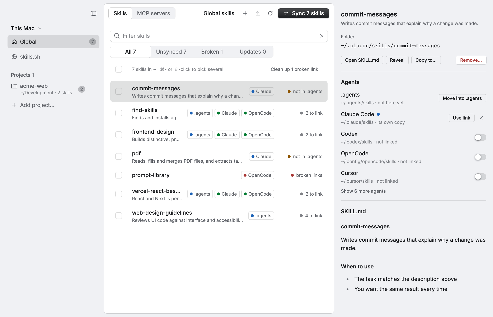
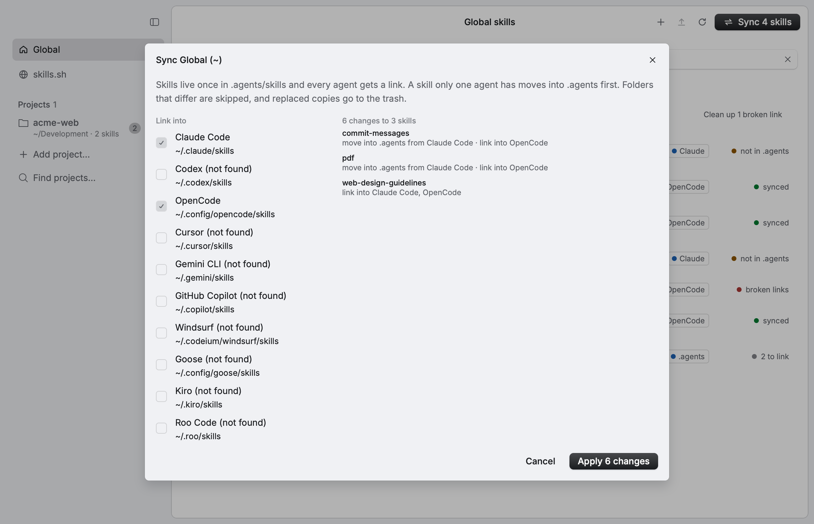
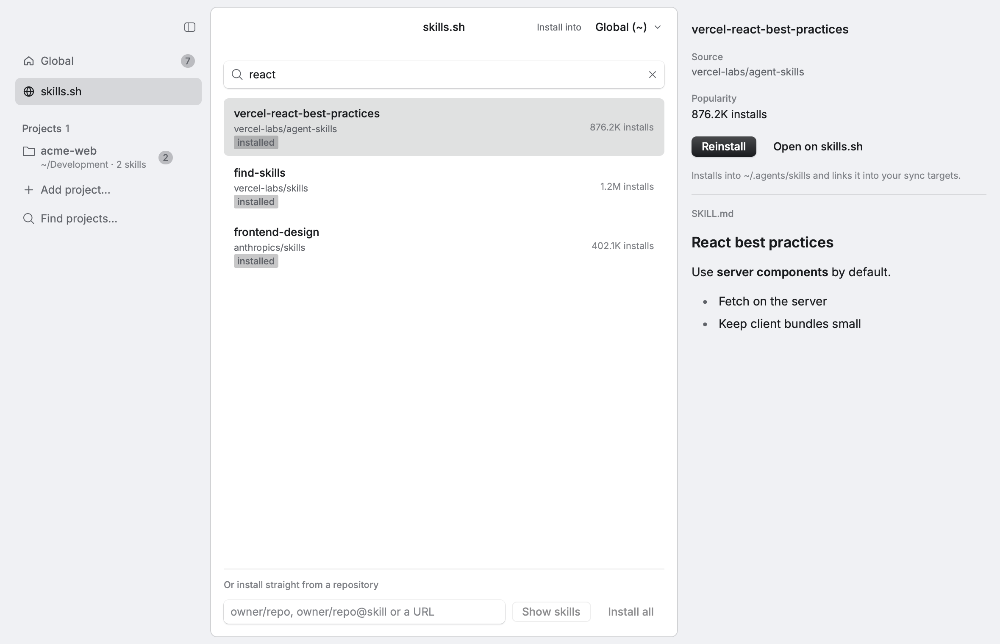
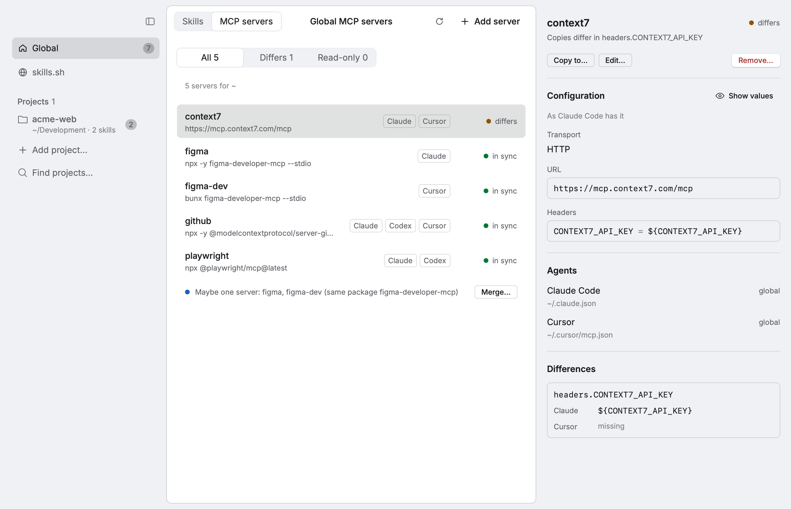
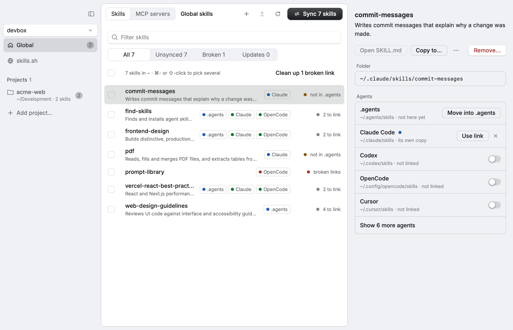

<div align="center">


# Prism

**One home for your agent skills, linked into every coding agent.**

A native app for macOS and Linux to browse the skills on your machine, install new ones from [skills.sh](https://skills.sh), and keep Claude Code, Codex, OpenCode, Cursor and the rest in sync, globally or per project.


[](https://github.com/gooonzick/prism/actions/workflows/ci.yml)


<picture>
  <source media="(prefers-color-scheme: dark)" srcset="docs/detail-dark.png">
  
</picture>

</div>

## Why

Every coding agent looks for skills in its own folder: `~/.claude/skills`, `~/.codex/skills`, `~/.config/opencode/skills`, and more in every project. Install a skill for one agent and the others never see it. Copies drift apart, links break, and nothing shows you the whole picture.

Prism keeps **one real copy** of each skill in `.agents/skills`, the same place the [`skills` CLI](https://github.com/vercel-labs/skills) puts them, and links it into every agent you use.

```
~/.agents/skills/find-skills            ← the skill itself
~/.claude/skills/find-skills            → ../../.agents/skills/find-skills
~/.config/opencode/skills/find-skills   → ../../../.agents/skills/find-skills
```

## Features

- **See everything in one place.** Every skill in `~` or in a project, which agents have it, and whether each one is a link, its own copy, or a broken link.
- **Sync with a preview.** Prism shows the full plan before it changes anything:
  - a skill only one agent has moves into `.agents` and is linked back;
  - identical copies are replaced with links;
  - folders that differ are skipped, never overwritten.
- **Install from skills.sh.** Search the index, preview `SKILL.md`, list every skill in a repository and pick the ones you want. Installs and updates run through the official `skills` CLI.
- **Updates.** Prism checks your skills against their sources in the background and updates one, several, or all of them.
- **MCP servers.** One list of the MCP servers in Claude Code, Claude Desktop, Codex, Cursor, OpenCode, Gemini CLI, Windsurf and Kiro, with the agents that have each one. Prism shows where copies differ, suggests merging servers that are one under two names, and adds, copies, edits or removes a server in several agents' configs at once, leaving the rest of each file as it was. Env and header values stay hidden until you reveal them.
- **Projects.** *Add project* takes a project folder, or a folder that holds projects: then it lists the ones with skills inside so you can add several at once. Skills move between scopes with *Copy to*.
- **Safe by default.** Nothing is deleted outright: replaced folders go to the Trash (the freedesktop trash on Linux, so your file manager can put them back). The last change (a sync, remove, cleanup or copy) can be undone with ⌘Z.
- **Live.** Prism watches the skill folders, so changes from the terminal, an editor or git show up on their own.
- **Fast and native.** Written in Rust on [Rune](https://github.com/anomalyco/rune), with a GPU-drawn UI in light and dark.

<table>
  <tr>
    <td></td>
    <td></td>
  </tr>
  <tr>
    <td align="center">Every sync shows its plan first</td>
    <td align="center">Search and install from skills.sh</td>
  </tr>
  <tr>
    <td colspan="2"></td>
  </tr>
  <tr>
    <td colspan="2" align="center">MCP servers across agents, with the differences between copies</td>
  </tr>
</table>

## Supported agents

| Agent | Global folder | Project folder |
| --- | --- | --- |
| Shared store | `~/.agents/skills` | `.agents/skills` |
| Claude Code | `~/.claude/skills` | `.claude/skills` |
| Codex | `~/.codex/skills` | `.codex/skills` |
| OpenCode | `~/.config/opencode/skills` | `.opencode/skills` |
| Cursor | `~/.cursor/skills` | `.cursor/skills` |
| Gemini CLI | `~/.gemini/skills` | `.gemini/skills` |
| GitHub Copilot | `~/.copilot/skills` | `.github/skills` |
| Windsurf | `~/.codeium/windsurf/skills` | `.windsurf/skills` |
| Goose | `~/.config/goose/skills` | `.goose/skills` |
| Kiro | `~/.kiro/skills` | `.kiro/skills` |
| Roo Code | `~/.roo/skills` | `.roo/skills` |

By default Prism links into the agents installed on your machine; you can change the list in the Sync dialog. `CLAUDE_CONFIG_DIR`, `CODEX_HOME` and `XDG_CONFIG_HOME` are respected.

## Install

### Homebrew (macOS)

```bash
brew tap gooonzick/tap && brew trust gooonzick/tap
brew install --cask gooonzick/tap/prism
```

This installs `Prism.app` (Apple silicon) and puts `prism` on your `PATH`. The app isn't notarized; the cask clears the download flag so it opens without a Gatekeeper prompt. Run `prism setup` once to install the `prism` skill for your agents.

### Download

Grab the latest build from [Releases](https://github.com/gooonzick/prism/releases/latest).

**macOS** (Apple silicon): unzip `prism-*-macos-arm64.zip` and move `Prism.app` to Applications. The app isn't notarized, so clear the download flag once before opening it:

```bash
xattr -dr com.apple.quarantine /Applications/Prism.app
```

**Linux** (x86_64 or arm64, Wayland or X11): unpack the tarball and run its installer. It puts `prism`, a desktop entry and the icon into `~/.local`, so Prism appears in your app launcher.

```bash
tar -xzf prism-*-linux-*.tar.gz
./prism-*/install.sh
```

For skills.sh, Prism needs Node.js with `pnpx`, `npx` or `bunx`.

### Build from source

You need [Rust](https://rustup.rs); the pinned toolchain installs itself.

```bash
git clone https://github.com/gooonzick/prism.git
cd prism
./scripts/bundle-macos.sh --install    # macOS: Prism.app in ~/Applications
./scripts/package-linux.sh --install   # Linux: prism in ~/.local
```

On Linux, install the build dependencies first. On Debian and Ubuntu:

```bash
sudo apt install pkg-config libwayland-dev libxkbcommon-dev libdbus-1-dev
```

To run it straight from the terminal, optionally opening a project:

```bash
cargo run --release -- ~/path/to/project
```

## Command line

The app is also a command line tool, for you and for your agents. With Homebrew, `prism` is already on your `PATH`. Otherwise, on macOS, choose **Install Command Line Tool…** in the app menu, or run the binary inside the app once:

```bash
/Applications/Prism.app/Contents/MacOS/prism setup
```

`prism setup` links `prism` into `~/.local/bin` (or `/usr/local/bin`) and installs the `prism` skill, which tells Claude Code, Codex and the rest how to use it. On Linux the installer already put `prism` on your `PATH`; `setup` checks that and installs the skill.

```bash
prism skills list                         # every skill and the agents that have it
prism mcp list                            # every MCP server, with drift and merge hints
prism doctor --all                        # broken links, invalid skills, servers that differ
prism mcp add github --command npx --arg -y --arg @modelcontextprotocol/server-github \
  --env GITHUB_TOKEN=@token.txt --to claude cursor codex
```

Commands that change or remove something print their plan first and act only with `--apply`. Pass the plan's id back, and Prism stops if anything changed in between:

```bash
prism skills sync
# Plan 3f9c2a1b7d40:
#   - Link pdf into Codex
# Run again with --apply --plan-id 3f9c2a1b7d40 to do it.
prism skills sync --apply --plan-id 3f9c2a1b7d40
prism undo                                # takes back the last change, from here or the app
```

Add `--json` to any command for output a script or an agent can read. Secrets print as `***` unless you ask for `--show-secrets`; pass them in with `KEY=@file` or `KEY=-` (stdin) to keep them out of your shell history. Several `KEY=-` share stdin, their values apart by NUL bytes (`--env` ones first, then `--header` ones).

## Other machines

Prism also works on the machines you reach over ssh: a dev box, a server, your other laptop. It connects with your own ssh setup (keys, agent, `~/.ssh/config`), never a password, and runs `prism` there.



**Hosts.** Save a machine under a name, with what follows `ssh`:

```bash
prism hosts add devbox --ssh me@devbox.lan   # or an alias from ~/.ssh/config
prism hosts check devbox                     # reachable, and running this version of prism?
prism hosts install devbox                   # put this version in ~/.local/bin there
prism hosts list
```

The host needs the same version of `prism` as this machine. Each release carries a CLI-only build, without the window, for that: `prism-cli-X.Y.Z-linux-x86_64.tar.gz`, `prism-cli-X.Y.Z-linux-arm64.tar.gz` and `prism-cli-X.Y.Z-macos-arm64.tar.gz`, each holding one file, `prism`, and all listed in `SHA256SUMS`; the Linux ones are static (musl), so they run whatever the host's glibc. `prism hosts install` downloads the matching archive on the host, checks it against `SHA256SUMS`, runs it there to see that it reports this version, and only then puts `prism` in `~/.local/bin`; nothing else there changes. Use `--binary PATH` to upload a build of your own instead. A `~/.local/bin/prism` there that is another program stays unless you pass `--force`.

**The switcher.** The machine menu above the scopes lists this machine, your saved hosts and *Add host…*. Pick a host and the window shows its skills, projects and MCP servers, and every action (sync, link, remove, edit a server, undo) acts there. A host without this version of `prism` offers *Install prism*; one that doesn't answer says why and offers *Retry*. skills.sh installs always land on this machine; copy them across afterwards.

**Copy across.** *Copy to…* on skills, and on an MCP server, lists your other machines next to the scopes of this one, so a skill or a server goes from this Mac to a host, from a host back here, or between two hosts. Each copy shows its plan first, as every change does, and the plan says what will need fixing there, such as a command path that only exists here. Secrets travel inside ssh on stdin, never in a command line. From the terminal:

```bash
prism skills copy pdf emil-animations --to-host devbox --to-global
prism skills copy pdf --to-host devbox --to-project /home/me/site --apply
prism mcp copy mobbin --to-host devbox --to claude codex
prism mcp copy github --to-host devbox --to claude --to-project /home/me/site --claude-scope project
```

**`--host`.** Any command runs on a host with `--host NAME`, its output and exit code as the host gives them: `prism --host devbox doctor`, `prism --host devbox mcp list --json`. A copy to a host is one change there, so `prism --host devbox undo` takes it back.

## Keyboard

On Linux, ⌘ is Ctrl.

| Keys | Action |
| --- | --- |
| ↑ ↓ | Move through the list |
| ⇧↑ ⇧↓, ⇧-click | Select a range |
| ⌘-click, Space | Select a skill |
| ⌘A | Select all |
| Esc | Clear the selection |
| ⌘N | New skill |
| ⌘Z | Undo the last change |
| ⌘R | Rescan |
| ⌘F | Filter |
| ⌘K | Search skills.sh |
| ⇧⌘B | Toggle the sidebar |

## Development

```bash
cargo test                    # core and UI tests, headless, on a throwaway $HOME
cargo test -- --ignored       # also hit skills.sh and GitHub; the e2e_ ones need the container below
./scripts/demo-home.sh        # rebuild the screenshots in docs/ from a demo home
```

The end to end tests reach a Linux container over a real ssh, so they need Docker running (on macOS, start Colima with `colima start`, or Docker Desktop); the script checks `docker info` first and says so when it doesn't answer. `scripts/e2e-ssh.sh` starts the container with a throwaway key and the CLI-only Linux build of `prism`, the static musl build releases ship; it keeps everything in `~/.cache/prism-e2e` and never touches your `~/.ssh`:

```bash
./scripts/e2e-ssh.sh && cargo test -- --ignored e2e_
./scripts/e2e-ssh.sh --down   # stop the container and delete ~/.cache/prism-e2e
```

Any screen renders without a window, which is handy for checking layout:

```bash
./target/debug/prism --snap out.png --scene sync --theme dark
```

Scenes: `detail`, `sync`, `remove`, `bulk`, `bulk-remove`, `updates`, `copy`, `copy-to-host`, `new-skill`, `browse`, `repo`, `notice`, `found`, `mcp`, `mcp-add`, `mcp-copy`, `env-remote`, `env-unreachable`.

| Path | What it does |
| --- | --- |
| `src/agents.rs` | the agents and their skill folders |
| `src/scan.rs` | what is installed where: folder, link, foreign or broken link |
| `src/sync.rs` | sync plans, linking, removing, copying, broken links |
| `src/fsops.rs` | the change journal behind undo, and the Trash |
| `src/remote.rs` | skills.sh search, previews from GitHub, the `skills` CLI |
| `src/mcp/` | MCP servers: each agent's config format, scans, plans and edits |
| `src/cli/` | the `prism` command line and `prism setup` |
| `src/hosts/` | saved hosts, running `prism` over ssh, installing it there, copies between machines |
| `src/app/` | app state and actions |
| `src/ui/` | the screens, built with rune-kit |

## License

[MIT](LICENSE)
