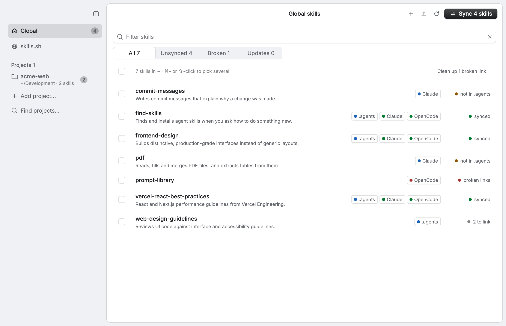

# Prism

Нативное приложение на Rust + [Rune](https://github.com/anomalyco/rune) для работы со скиллами агентов:

- **просмотр** всех установленных скиллов — глобально (`~`) и в любой папке проекта;
- **skills.sh** как источник: поиск по индексу, превью `SKILL.md`, список скиллов репозитория, установка и обновление через CLI `skills`;
- **синхронизация** между `.agents/skills` и папками агентов: `.claude`, `.codex`, `.opencode`, `.cursor`, `.gemini`, `.github` (Copilot), `.windsurf`, `.goose`, `.kiro`, `.roo`.



## Как устроена синхронизация

`.agents/skills/<skill>` — единственная настоящая копия (так же раскладывает CLI skills.sh). В папке каждого агента лежит относительный симлинк на неё.

Кнопка **Sync** показывает план и ничего не меняет, пока его не подтвердишь:

- скилл, который есть только у одного агента, переезжает в `.agents` и линкуется обратно;
- ссылка агента на внешнюю папку становится ссылкой `.agents/<skill>` на ту же папку;
- одинаковая копия у агента заменяется ссылкой (копия уходит в корзину);
- разные копии и чужие ссылки не трогаются, а показываются как пропущенные.

Агенты для синка выбираются в диалоге Sync. По умолчанию это те, чья папка конфигурации есть на машине. Выбор сохраняется в `~/Library/Application Support/dev.prism.skills/settings.json` вместе со списком проектов.

**Undo.** Каждая ссылка, удаление ссылки и перемещение пишутся в журнал. Последнее изменение (синк, удаление, очистка, копирование) откатывается кнопкой Undo в уведомлении или ⌘Z. Ничего не удаляется насовсем: папки уходят в корзину.


## Список

- Вкладки **All / Unsynced / Broken / Updates** и поиск по имени и описанию.
- **Clean up N broken links** убирает ссылки в никуда одним нажатием.
- Метки показывают, где лежит скилл; **update** — на skills.sh есть новее; **also global** — проектный скилл с тем же именем, что и глобальный.
- Выбор нескольких: чекбоксы, ⌘-клик (переключить), ⇧-клик (диапазон), ⌘A, Space, ⇧↑/⇧↓. Для выбранных: **Sync**, **Update**, **Copy to…**, **Remove…**.
- ↑/↓ двигают выделение, инспектор показывает выбранный скилл.
- Папки скиллов отслеживаются: изменения из терминала, CLI или редактора появляются сами.

В инспекторе: **Open SKILL.md**, **Reveal**, **Copy to…** (в другой скоуп), **Remove…**, переключатель ссылки для каждого агента. У собственной копии агента — **Use link** (заменить ссылкой) и ✕ (в корзину).

**New skill** (⌘N) создаёт `.agents/skills/<name>/SKILL.md` с frontmatter, линкует его и открывает в редакторе.


## Проекты

**Add project…** добавляет папку, **Find projects…** ищет в выбранной папке (до 4 уровней) проекты, где уже есть скиллы, и предлагает добавить их пачкой. В сайдбаре у каждого скоупа бейдж с числом несинхронизированных скиллов.

## skills.sh

Поиск идёт через `https://skills.sh/api/search`. Установка вызывает
`skills add <owner/repo> --skill <id…> --agent codex --yes [--global]` в корне выбранного скоупа: для этого CLI папка Codex и есть `.agents/skills`, поэтому скилл попадает только в каноническое хранилище. Дальше приложение само линкует его в выбранных агентов.

Поле внизу принимает `owner/repo`, `owner/repo@skill`, GitHub-ссылку или ссылку на skills.sh. **Show skills** показывает скиллы репозитория (`skills add -l`) с чекбоксами, **Install all** ставит всё.

Обновления: при открытии скоупа приложение в фоне вызывает `skills check`, кнопка ↑ в тулбаре проверяет заново, **Update** вызывает `skills update`.


## Запуск

Нужен Rust 1.99.1 (закреплён в `rust-toolchain.toml`) и Node.js (pnpx, npx или bunx) для skills.sh.

```bash
./scripts/bundle-macos.sh --install   # собрать «Prism.app» и положить в ~/Applications
```

```bash
cargo run --release -- ~/path/to/project   # из терминала, сразу открыв проект
```

Горячие клавиши: ⌘N — новый скилл, ⌘Z — отменить, ⌘R — пересканировать, ⌘K — skills.sh, ⌘F — поиск, ⌘A — выбрать все, Esc — снять выбор, ↑/↓ — по списку, Space — отметить, ⇧⌘B — сайдбар.

## Разработка

```bash
cargo test                       # ядро + UI в headless-режиме на временном $HOME
cargo test -- --ignored          # с сетью: установка из skills.sh, список репозитория, проверка обновлений
./target/debug/prism --snap out.png --scene sync --theme dark   # снимок без окна
```

Сцены: `detail`, `sync`, `remove`, `bulk`, `bulk-remove`, `updates`, `copy`, `new-skill`, `browse`, `repo`, `notice`.

| Файл | Что делает |
| --- | --- |
| `src/agents.rs` | таблица агентов и их папок (глобально и в проекте) |
| `src/scan.rs` | что где установлено: папка, ссылка в `.agents`, чужая или битая ссылка |
| `src/sync.rs` | план синхронизации, link / unlink / remove / copy, битые ссылки |
| `src/fsops.rs` | журнал изменений на диске и Undo, корзина |
| `src/remote.rs` | поиск на skills.sh, превью с GitHub, CLI `skills` (add, check, update, list) |
| `src/app/` | состояние и действия: список, skills.sh, слежение за папками, поиск проектов |
| `src/ui/` | экраны на rune-kit: сайдбар, список, инспектор, диалоги |
| `scripts/bundle-macos.sh` | сборка `.app` с иконкой из `assets/icon.svg` |
